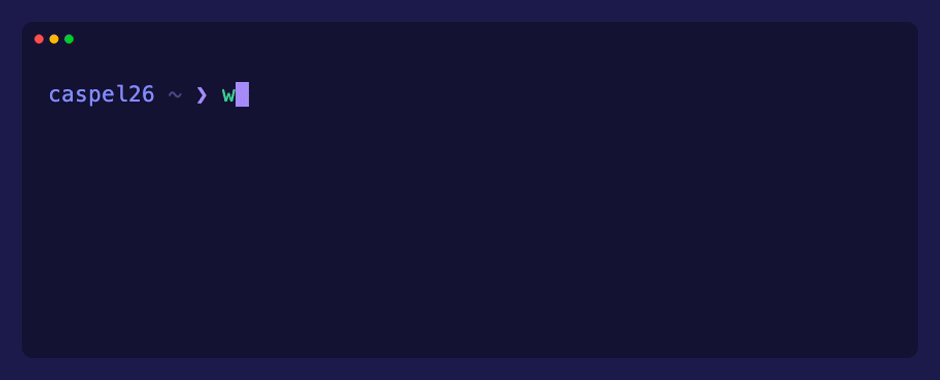

<div align="center">




<a href="https://caspel26.github.io"></a>

</div>

<!-- ============ ABOUT ============ -->
### About Me

I write backend software for a living — cybersecurity and PKI with the Namirial Group — and frameworks, developer tools and small products for fun. Mostly Python and Go, almost always around APIs. I work AI-first: prompt engineering and agentic programming are part of how I design, build and test.

```python
caspel26 = {
    "work":      "cybersecurity · PKI @ Namirial Group",
    "languages": ["Python", "Go", "TypeScript"],
    "likes":     ["backend", "APIs", "developer tools"],
    "practice":  "AI-first · agentic programming",
    "editor":    "Lilac Nights, obviously",
    "portfolio": "https://caspel26.github.io",
}
```

Outside the day job, I maintain **[django-ninja-aio-crud](https://github.com/caspel26/django-ninja-aio-crud)**, an async CRUD framework for Django Ninja with 50+ stars, and **[goninja](https://github.com/caspel26/goninja)**, its Go counterpart — same idea, opposite approach: it generates the CRUD as real Go source instead of resolving it at runtime. I'm also building **[shimwire](https://github.com/caspel26/shimwire)**, a Bun/TypeScript CLI that mocks and tests APIs from the same OpenAPI spec.

<!-- ============ FEATURED PROJECTS ============ -->
### Featured Projects

#### [django-ninja-aio-crud](https://github.com/caspel26/django-ninja-aio-crud)

Async dynamic CRUD framework for Django Ninja.

- ⚡ Async-first API generation
- 🔐 Built-in authentication
- 🔎 Filtering & pagination
- 🧩 Dynamic model CRUD
- 📦 Automatic serialization
- 🤖 MCP server for AI agents — expose ViewSets as tools any MCP client can call directly, zero glue code
- 🐍 Django + Django Ninja

[Documentation](https://django-ninja-aio.com) · [PyPI](https://pypi.org/project/django-ninja-aio-crud/) · [GitHub](https://github.com/caspel26/django-ninja-aio-crud)

```
pip install django-ninja-aio-crud
```

   


<br>

#### [goninja](https://github.com/caspel26/goninja)

Code-first CRUD REST APIs for Go, generated from annotated structs.

- 🧬 Annotate a struct, run one command, get real `.go` files you commit
- 🚫 Zero reflection on the request path — a bad tag fails `go build`, not production
- 🧷 Output types are separate structs, so a field can't leak into a response
- 🪢 No N+1 by construction — `list` never preloads, `retrieve` preloads what it carries
- 🔎 Filters, range queries, ordering and limit/offset pagination
- 🔐 `Authenticator` objects, per-route policy, reflected into the OpenAPI security schemes
- 📘 OpenAPI 3.0 with Swagger UI and ReDoc embedded — no external CDN
- 🐹 Plain `net/http` + GORM, no custom router

[Documentation](https://goninja.dev) · [Changelog](https://goninja.dev/docs/changelog/) · [GitHub](https://github.com/caspel26/goninja)

```
go install github.com/caspel26/goninja/cmd/goninja@latest
```

    


<br>

#### [shimwire](https://github.com/caspel26/shimwire)

One CLI for both sides of an API you don't fully control yet — mocks the parts that aren't built, and tests the parts that are, from a single OpenAPI/Swagger spec.

- 🔀 Spec-driven mock server and test collections, from one shared engine
- 📁 Git-native collections — plain TOML, reviewable in a normal PR diff
- 🎭 Schema-aware fake data, not just random junk
- 🎯 Overrides for status/latency/exact-body edge-case testing
- 🖱️ Guided interactive menu, or full CI-friendly flags
- 📊 HTML reports and `--fail-on-error` for CI
- 🤖 MCP server — an AI agent can inspect a spec, scaffold a project, and verify it actually works, without knowing shimwire's flags

[GitHub](https://github.com/caspel26/shimwire)

```
npm install -g shimwire
```

     


<br>

#### [lilac-nights](https://github.com/caspel26/lilac-nights)

A dark VS Code theme with a lilac spine — built to be read for eight hours straight.

- 🟣 Purple carries the structure — keywords, properties, decorators
- 🎨 Every other hue has exactly one job, so nothing looks alike by accident
- 🔍 Semantic-token aware, down to `variable.classMember` for Python attributes
- ♿ Every syntax color clears WCAG AA against the editor background
- 🖥️ Full workbench, terminal ANSI, diff, debug and notebook coverage

[Open VSX](https://open-vsx.org/extension/caspel26/lilac-nights) · [GitHub](https://github.com/caspel26/lilac-nights)

```
codium --install-extension caspel26.lilac-nights
```

    

Previews — click a language to open it here:

<details>
<summary></summary>
<br>

</details>

<details>
<summary></summary>
<br>

</details>

<details>
<summary></summary>
<br>

</details>

<details>
<summary></summary>
<br>

</details>

<details>
<summary></summary>
<br>

</details>

<details>
<summary></summary>
<br>

</details>

<!-- ============ CURRENTLY ============ -->
### Currently

- Building async CRUD/backend infrastructure in Python and Go
- Integrating LLMs into production backends — tool calling, agentic workflows, structured outputs, RAG, async/streaming inference
- Exploring system design and architecture patterns for async services

<!-- ============ STACK ============ -->
### Stack

<p>
<br>
<sub><b>Languages</b></sub>
</p>

<p>
<br>
<sub><b>Backend</b> · also Django Ninja, Gin, Echo, Huma, GORM</sub>
</p>

<p>
<br>
<sub><b>Frontend</b> · also Framer Motion · used in my projects, with AI assistance for the implementation</sub>
</p>

<p>
<br>
<sub><b>Data</b></sub>
</p>

<p>
<br>
<sub><b>DevOps</b> · also HAProxy, Oracle Cloud</sub>
</p>

<p><sub><b>Testing</b> · Pytest · Playwright</sub><br>
<sub><b>AI · LLM</b> · Anthropic · OpenAI · Gemini · Perplexity</sub></p>

<!-- ============ OTHER PROJECTS ============ -->
### Other Projects

- **[Shiori](https://myshiori.eu)** — an anime discovery and tracking product, in public beta (Go, PostgreSQL)
- **[mana-oly-tools](https://mana-oly-tools.pages.dev/)** — community calculators, planners and trackers for Olympus Prison on ManaCube
- **[ninja-aio-blog-example](https://github.com/caspel26/ninja-aio-blog-example)** — production-oriented example integrating django-ninja-aio-crud with JWT (RS256) authentication

#### Other Experiments

- **[ssh-manager](https://github.com/caspel26/ssh-manager)** — a Vue-based SSH connection manager
- **[password_manager](https://github.com/caspel26/password_manager)** — a desktop password manager (Electron, Vue 3, TypeScript) that keeps credentials in encrypted local vault files

<!-- ============ CONNECT ============ -->
### Connect

<a href="https://caspel26.github.io"></a> <a href="https://www.linkedin.com/in/giuseppe-casillo-3737b128b/"></a> <a href="mailto:peppe.c0126@gmail.com"></a> <a href="https://github.com/caspel26"></a>


